# RAPPORT DE PROJET — MODULE C106

## Gestion d’une pizzeria avec livraisons (ThanosPizza) — Rendu Final (100%)

---

### INFORMATIONS GÉNÉRALES

- **Nom et prénom de l’apprenti :** Maksym Tsybulevskyi
- **Lieu de formation :** ETML, Avenue de Valmont 28B, 1010 Lausanne
- **Module :** C106 — Interroger, traiter et assurer la maintenance des bases de données
- **SGBD utilisé :** MySQL 8.0 (Environnement conteneurisé Docker) & phpMyAdmin
- **Outil de modélisation :** Looping (MERISE)
- **Date de réalisation :** Année scolaire 2026 – 2027

---

## Table des matières

1. [Introduction et contexte](#1-introduction-et-contexte)
2. [Modélisation MERISE (Section 3.1)](#2-modélisation-merise-section-31)
    - 2.1 Modèle Conceptuel de Données (MCD)
    - 2.2 Choix de modélisation
    - 2.3 Modèle Logique de Données (MLD)
3. [Création de la base et des tables (Section 3.2)](#3-création-de-la-base-et-des-tables-section-32)
    - 3.1 Environnement technique
    - 3.2 Script DDL
    - 3.3 Renforcement des contraintes et valeurs autorisées (Améliorations Jalon 50%)
    - 3.4 Contraintes CHECK de robustesse des données (Améliorations Jalon 80%)
4. [Chargement des données (Section 3.3)](#4-chargement-des-données-section-33)
5. [Sauvegarde et restauration (Section 3.4)](#5-sauvegarde-et-restauration-section-34)
6. [Requêtes SQL (Section 3.5)](#6-requêtes-sql-section-35)
7. [Analyse et optimisation des index (Section 3.6)](#7-analyse-et-optimisation-des-index-section-36)
8. [Gestion des utilisateurs et des rôles (Section 3.7)](#8-gestion-des-utilisateurs-et-des-rôles-section-37)
9. [Transactions et intégrité des données (Section 3.8)](#9-transactions-et-intégrité-des-données-section-38)
10. [Utilisation de l’intelligence artificielle (Section 3.9)](#10-utilisation-de-lintelligence-artificielle-section-39)
11. [Validation et signatures](#11-validation-et-signatures)

---

## 1. Introduction et contexte

La pizzeria **ThanosPizza** souhaite informatiser l’intégralité de sa gestion opérationnelle. Le système d’information doit prendre en charge trois modes de consommation :

- Sur place
- À emporter
- En livraison à domicile

Les impératifs majeurs du système reposent sur la conservation d’un **historique financier fiable et immuable** (prix des articles et des suppléments au moment de la commande, fractionnement des paiements), ainsi que sur le **suivi logistique rigoureux des tournées de livraison** (affectation d’un livreur unique, suivi des horaires de départ et d’arrivée, conformité des adresses).

Le présent rapport documente chaque phase de conception, d’implémentation, d’interrogation et d’administration de la base de données relationnelle.

---

## 2. Modélisation MERISE (Section 3.1)

### 2.1 Modèle Conceptuel de Données (MCD)

La modélisation a été conduite avec le logiciel **Looping**. Deux itérations majeures ont été réalisées pour parvenir au schéma conceptuel validé.

#### Première ébauche du MCD (version initiale)

La première modélisation comportait quelques imprécisions, notamment au niveau des cardinalités de livraison et de la définition des attributs de certaines entités :

[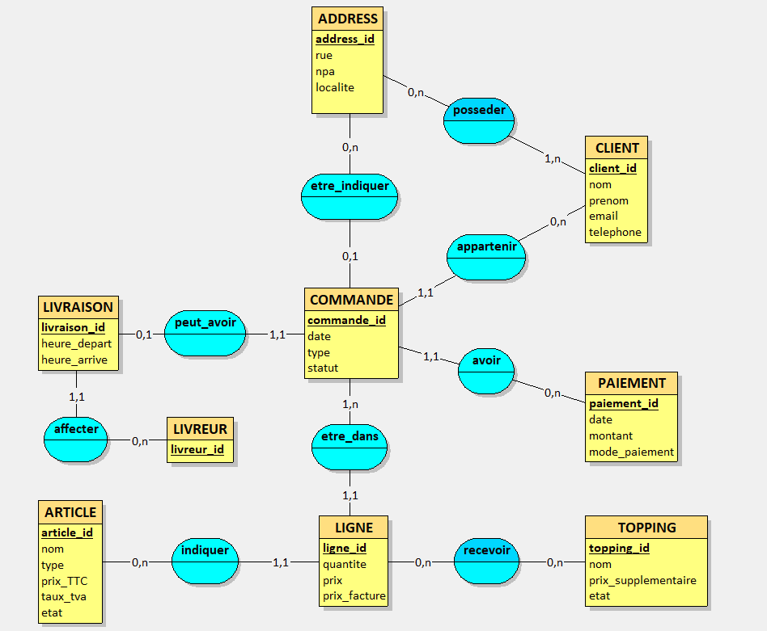](images/mcd_ancienne_version.png)
🔍 *[Ouvrir l'image en taille réelle : mcd_ancienne_version.png](images/mcd_ancienne_version.png)*

#### Version finale et validée du MCD

Après ajustement des contraintes métier du cahier des charges, le schéma final a été consolidé :

[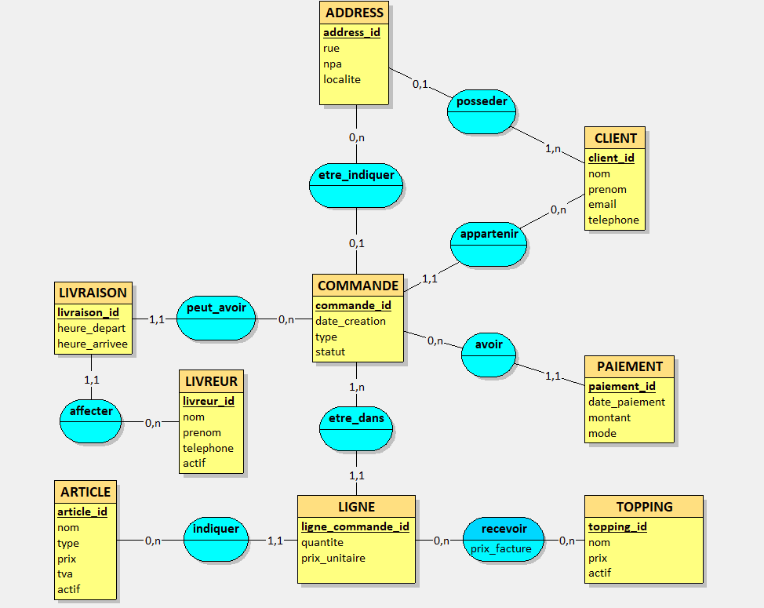](images/mcd_version_finale.png)
🔍 *[Ouvrir l'image en taille réelle : mcd_version_finale.png](images/mcd_version_finale.png)*

---

### 2.2 Justification des choix de modélisation

Conformément aux attendus du cahier des charges, voici les explications des choix conceptuels majeurs :

1. **Gestion des toppings et traçabilité des prix :**
Un topping n’est pas un article indépendant du catalogue mais un supplément applicable à une ligne de commande concernant une pizza. L’association `recevoir` entre `LIGNE` et `TOPPING` est de type many-to-many ($0,n$ de chaque côté). L’attribut `prix_facture` est directement porté par cette association (qui devient la table `t_ligne_topping`). Cela permet de figer le prix facturé du topping au moment de la vente, même si le prix catalogue du supplément change ultérieurement.
2. **Cardinalité de la relation Livraison — Commande :**
Une commande de type livraison donne lieu à **au maximum une seule livraison**. Dans le MCD, la commande est reliée à la livraison avec une cardinalité $(0,1)$ ou $(0,n)$ (au sens où la livraison référence une et une seule commande : $1,1$). Cela garantit qu’une commande sur place ou à emporter n’a aucune livraison ($0$), tandis qu’une commande à livrer en possède une unique.
3. **Multiplicité des adresses et indépendance des comptes clients :**
L’entité `CLIENT` est reliée à `ADRESSE` par $(0,n)$ côté client et $(1,1)$ côté adresse (chaque adresse enregistrée appartient obligatoirement à un et un seul client). Un client peut enregistrer plusieurs adresses (domicile, bureau, etc.). De plus, la relation entre `CLIENT` et `COMMANDE` est de type $(0,n)$, permettant d’enregistrer un client dans le système avant même qu’il n’ait validé son premier achat.

---

### 2.3 Modèle Logique de Données (MLD)

La traduction du MCD selon les règles formelles de normalisation relationnelle produit le MLD suivant (clés primaires soulignées `<u>...</u>`, clés étrangères précédées d’un dièse `#`) :

- **t_client** (<u>client_id</u>, nom, prenom, email, telephone)
- **t_adresse** (<u>adresse_id</u>, rue, npa, localite, #client_fk)  
  *(Contrainte d'unicité composite : `UNIQUE (client_fk, adresse_id)`)*
- **t_article** (<u>article_id</u>, nom, type, prix, tva, actif)
- **t_topping** (<u>topping_id</u>, nom, prix, actif)
- **t_commande** (<u>commande_id</u>, date_creation, type, statut, #client_fk, #adresse_livraison_fk)  
  *(Clé étrangère composite : `(#client_fk, #adresse_livraison_fk)` référence `t_adresse(client_fk, adresse_id)`)*
- **t_ligne_commande** (<u>ligne_commande_id</u>, quantite, prix_unitaire, #commande_fk, #article_fk)
- **t_ligne_topping** (<u>#ligne_commande_fk</u>, <u>#topping_fk</u>, prix_facture)
- **t_paiement** (<u>paiement_id</u>, date_paiement, montant, mode, #commande_fk)
- **t_livreur** (<u>livreur_id</u>, nom, prenom, telephone, actif)
- **t_livraison** (<u>livraison_id</u>, heure_depart, heure_arrivee, #commande_fk, #livreur_fk)  
  *(Contrainte d'unicité : `UNIQUE (#commande_fk)` garantissant une livraison au maximum par commande)*
    

---

## 3. Création de la base et des tables (Section 3.2)

### 3.1 Environnement technique

Le déploiement est réalisé sous **Docker**, à l’aide d’un conteneur officiel MySQL 8.0.
Pour permettre le chargement rapide des fichiers volumineux avec `LOAD DATA LOCAL INFILE`, la variable globale correspondante est activée.

```bash
# Connexion au serveur MySQL dans le conteneur Docker avec autorisation de local-infile
mysql --local-infile=1 -uroot -proot
```

[](images/3.1%20Environnement%20technique.png)
*Preuve d’exécution : Connexion au conteneur Docker MySQL 8.0 avec support du chargement local.*


### 3.2 Script DDL (`[db_thanospizza.sql](./db/db_thanospizza.sql)`)

Le script crée la base de données avec encodage `utf8mb4` et met en place les tables en respectant les contraintes d’intégrité référentielle :

```sql
DROP DATABASE IF EXISTS db_thanospizza;
CREATE DATABASE IF NOT EXISTS db_thanospizza
DEFAULT CHARACTER SET utf8mb4
COLLATE utf8mb4_0900_ai_ci;

SET GLOBAL local_infile = 1;
USE db_thanospizza;

CREATE TABLE t_client (
   client_id INT AUTO_INCREMENT,
   nom VARCHAR(50) NOT NULL,
   prenom VARCHAR(50) NOT NULL,
   email VARCHAR(254) NOT NULL,
   telephone VARCHAR(20) NOT NULL,
   PRIMARY KEY (client_id)
) ENGINE=InnoDB;

CREATE TABLE t_adresse (
   adresse_id INT AUTO_INCREMENT,
   rue VARCHAR(100) NOT NULL,
   npa SMALLINT NOT NULL,
   localite VARCHAR(100) NOT NULL,
   client_fk INT NOT NULL,
   PRIMARY KEY (adresse_id),
   CONSTRAINT fk_adresse_client FOREIGN KEY (client_fk) REFERENCES t_client (client_id),
   CONSTRAINT uq_client_adresse UNIQUE (client_fk, adresse_id)
) ENGINE=InnoDB;

CREATE TABLE t_article (
   article_id INT AUTO_INCREMENT,
   nom VARCHAR(50) NOT NULL,
   type VARCHAR(50) NOT NULL,
   prix DECIMAL(7,2) CHECK(prix >= 0) NOT NULL,
   tva DECIMAL(3,1) NOT NULL,
   actif BOOLEAN NOT NULL DEFAULT 1,
   PRIMARY KEY (article_id)
) ENGINE=InnoDB;

CREATE TABLE t_topping (
   topping_id INT AUTO_INCREMENT,
   nom VARCHAR(50) NOT NULL,
   prix DECIMAL(5,2) CHECK(prix >= 0) NOT NULL,
   actif BOOLEAN NOT NULL DEFAULT 1,
   PRIMARY KEY (topping_id)
) ENGINE=InnoDB;

CREATE TABLE t_commande (
   commande_id INT AUTO_INCREMENT,
   date_creation DATETIME NOT NULL,
   type ENUM('sur_place', 'emporter', 'livraison') NOT NULL,
   statut ENUM('recue', 'en_preparation', 'en_livraison', 'livree', 'annulee') NOT NULL,
   adresse_livraison_fk INT NULL,
   client_fk INT NOT NULL,
   PRIMARY KEY (commande_id),
   CONSTRAINT fk_commande_adresse FOREIGN KEY (adresse_livraison_fk) REFERENCES t_adresse (adresse_id),
   CONSTRAINT fk_commande_client FOREIGN KEY (client_fk) REFERENCES t_client (client_id),
   CONSTRAINT fk_client_adresse FOREIGN KEY (client_fk, adresse_livraison_fk) REFERENCES t_adresse (client_fk, adresse_id)
) ENGINE=InnoDB;

CREATE TABLE t_ligne_commande (
   ligne_commande_id INT AUTO_INCREMENT,
   commande_fk INT NOT NULL,
   article_fk INT NOT NULL,
   quantite INT CHECK (quantite > 0) NOT NULL,
   prix_unitaire DECIMAL(10,2) CHECK(prix_unitaire >= 0) NOT NULL,
   PRIMARY KEY (ligne_commande_id),
   CONSTRAINT fk_ligne_commande FOREIGN KEY (commande_fk) REFERENCES t_commande (commande_id),
   CONSTRAINT fk_ligne_article FOREIGN KEY (article_fk) REFERENCES t_article (article_id)
) ENGINE=InnoDB;

CREATE TABLE t_ligne_topping (
   ligne_commande_fk INT NOT NULL,
   topping_fk INT NOT NULL,
   prix_facture DECIMAL(10,2) CHECK(prix_facture >= 0) NOT NULL,
   PRIMARY KEY (ligne_commande_fk, topping_fk),
   CONSTRAINT fk_lt_ligne FOREIGN KEY (ligne_commande_fk) REFERENCES t_ligne_commande (ligne_commande_id),
   CONSTRAINT fk_lt_topping FOREIGN KEY (topping_fk) REFERENCES t_topping (topping_id)
) ENGINE=InnoDB;

CREATE TABLE t_paiement (
   paiement_id INT AUTO_INCREMENT,
   commande_fk INT NOT NULL,
   date_paiement DATETIME NOT NULL,
   montant DECIMAL(10,2) CHECK(montant >= 0) NOT NULL,
   mode ENUM('carte', 'twint', 'cash', 'bon') NOT NULL,
   PRIMARY KEY (paiement_id),
   CONSTRAINT fk_paiement_commande FOREIGN KEY (commande_fk) REFERENCES t_commande (commande_id)
) ENGINE=InnoDB;

CREATE TABLE t_livreur (
   livreur_id INT AUTO_INCREMENT,
   nom VARCHAR(50) NOT NULL,
   prenom VARCHAR(50) NOT NULL,
   telephone VARCHAR(20) NOT NULL,
   actif BOOLEAN NOT NULL DEFAULT 1,
   PRIMARY KEY (livreur_id)
) ENGINE=InnoDB;

CREATE TABLE t_livraison (
   livraison_id INT AUTO_INCREMENT,
   commande_fk INT NOT NULL,
   livreur_fk INT NOT NULL,
   heure_depart DATETIME NULL,
   heure_arrivee DATETIME NULL,
   PRIMARY KEY (livraison_id),
   CONSTRAINT uq_livraison_commande UNIQUE (commande_fk),
   CONSTRAINT fk_livraison_commande FOREIGN KEY (commande_fk) REFERENCES t_commande (commande_id),
   CONSTRAINT fk_livraison_livreur FOREIGN KEY (livreur_fk) REFERENCES t_livreur (livreur_id)
) ENGINE=InnoDB;
```

[](images/3.2%20Script%20DDL.png)
*Preuve d’exécution : Création intégrale du schéma et des 10 tables dans MySQL.*

---

### 3.3 Renforcement des contraintes et valeurs autorisées (Améliorations Jalon 50%)

Suite au retour d’évaluation intermédiaire du jalon 50%, deux renforcements cruciaux ont été apportés au modèle relationnel :

#### 1. Garantie que l’adresse de livraison appartient bien au client de la commande
- **Problématique métier :** Dans la version initiale, une clé étrangère simple `t_commande.adresse_livraison_fk -> t_adresse.adresse_id` autorisait techniquement une faille d'intégrité : un client $A$ pouvait renseigner l'adresse d'un client $B$ pour sa commande de livraison.
- **Solution mise en œuvre :**
  1. Définition d'une contrainte d'unicité composite sur `t_adresse` :
     ```sql
     CONSTRAINT uq_client_adresse UNIQUE (client_fk, adresse_id)
     ```
  2. Création d'une clé étrangère composite sur `t_commande` :
     ```sql
     CONSTRAINT fk_client_adresse FOREIGN KEY (client_fk, adresse_livraison_fk) REFERENCES t_adresse (client_fk, adresse_id)
     ```
  Grâce à cette contrainte composite, le SGBD rejette automatiquement toute tentative de commande où l'adresse choisie ne correspond pas au client identifié.

| Conception initiale (avant) | Conception renforcée (après retour 50%) |
| :---: | :---: |
| [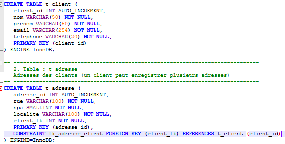](images/eval_adresse_avant_1.png)<br>[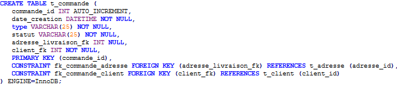](images/eval_adresse_avant_2.png) | [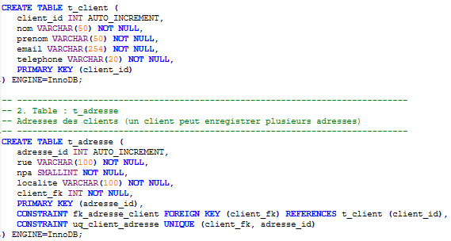](images/eval_adresse_apres_1.png)<br>[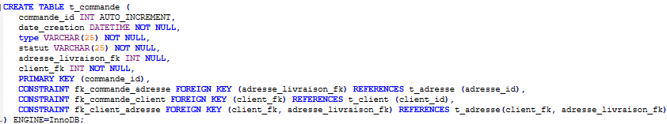](images/eval_adresse_apres_2.png) |

---

#### 2. Restriction stricte des valeurs autorisées (ENUM) et unicité des livraisons
- **Problématique métier :** L'usage de types `VARCHAR` laissait la porte ouverte à des saisies invalides ou à des coquilles typographiques (ex: modes de paiement ou statuts mal orthographiés). De plus, une même commande ne doit jamais donner lieu à plusieurs livraisons distinctes.
- **Solution mise en œuvre :**
  - **Types énumérés stricts (`ENUM`) :**
    - `t_commande(type)` : `ENUM('sur_place', 'emporter', 'livraison') NOT NULL`
    - `t_commande(statut)` : `ENUM('recue', 'en_preparation', 'en_livraison', 'livree', 'annulee') NOT NULL`
    - `t_paiement(mode)` : `ENUM('carte', 'twint', 'cash', 'bon') NOT NULL`
  - **Unicité de la livraison par commande :**
    - `t_livraison(commande_fk)` : `UNIQUE` pour empêcher l'attribution de tournées doublons pour une même commande.

| Conception initiale (avant) | Conception renforcée (après retour 50%) |
| :---: | :---: |
| [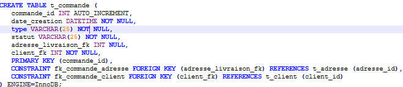](images/eval_enum_avant_1.png)<br>[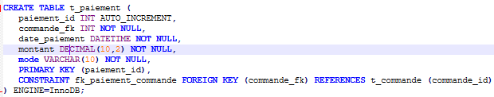](images/eval_enum_avant_2.png) | [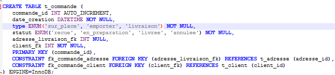](images/eval_enum_apres_1.png)<br>[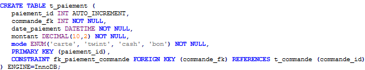](images/eval_enum_apres_2.png) |

---

### 3.4 Contraintes CHECK de robustesse des données (Améliorations Jalon 80%)

Conformément aux recommandations d'amélioration de robustesse émises lors du retour d’évaluation du jalon 80% ([`eval_retour_80%.docx`](./eval_retour_80%.docx)), des contraintes d'intégrité de domaine (`CHECK`) ont été intégrées directement au niveau du schéma relationnel sur l'ensemble des grandeurs monétaires et quantitatives :

1. **Garantie de montants financiers non négatifs :**
   - Catalogue des articles : `t_article(prix)` avec `CHECK (prix >= 0)`
   - Suppléments / toppings : `t_topping(prix)` avec `CHECK (prix >= 0)`
   - Tarification des lignes commandées : `t_ligne_commande(prix_unitaire)` avec `CHECK (prix_unitaire >= 0)`
   - Tarification des suppléments facturés : `t_ligne_topping(prix_facture)` avec `CHECK (prix_facture >= 0)`
   - Encaissellements : `t_paiement(montant)` avec `CHECK (montant >= 0)`

2. **Garantie de quantités strictement positives :**
   - Articles commandés : `t_ligne_commande(quantite)` avec `CHECK (quantite >= 0)`

Ces contraintes renforcent l’étanchéité du système contre les incohérences de saisie, les bogues applicatifs ou les corruptions de données en rejetant systématiquement au niveau du moteur MySQL toute tentative d'écriture de valeurs aberrantes.

---

## 4. Chargement des données (Section 3.3)

Les données ont été fournies sous forme de 10 fichiers `.tsv` (Tab-Separated Values). L’importation s’effectue au moyen de commandes `LOAD DATA LOCAL INFILE`.

### 4.1 Traitement des valeurs nulles et formatage

- Pour la table `t_commande`, les commandes à emporter et sur place n’ont pas d’adresse. L’utilisation d’une variable `@adresse` associée à la directive `SET adresse_livraison_fk = NULLIF(@adresse, '')` permet de convertir proprement les cellules vides du fichier texte en véritables valeurs `NULL` SQL.
- Pour la table `t_livraison`, le même procédé est appliqué sur `@heure_depart` et `@heure_arrivee`.

```sql
LOAD DATA LOCAL INFILE '/scripts/data/01_t_client.tsv'
INTO TABLE t_client
CHARACTER SET utf8mb4 FIELDS TERMINATED BY '\t' LINES TERMINATED BY '\n' IGNORE 1 LINES
(client_id, nom, prenom, email, telephone);

LOAD DATA LOCAL INFILE '/scripts/data/02_t_adresse.tsv'
INTO TABLE t_adresse
CHARACTER SET utf8mb4 FIELDS TERMINATED BY '\t' LINES TERMINATED BY '\n' IGNORE 1 LINES
(adresse_id, rue, npa, localite, client_fk);

LOAD DATA LOCAL INFILE '/scripts/data/03_t_article.tsv'
INTO TABLE t_article
CHARACTER SET utf8mb4 FIELDS TERMINATED BY '\t' LINES TERMINATED BY '\n' IGNORE 1 LINES
(article_id, nom, type, prix, tva, actif);

LOAD DATA LOCAL INFILE '/scripts/data/04_t_topping.tsv'
INTO TABLE t_topping
CHARACTER SET utf8mb4 FIELDS TERMINATED BY '\t' LINES TERMINATED BY '\n' IGNORE 1 LINES
(topping_id, nom, prix, actif);

LOAD DATA LOCAL INFILE '/scripts/data/05_t_livreur.tsv'
INTO TABLE t_livreur
CHARACTER SET utf8mb4 FIELDS TERMINATED BY '\t' LINES TERMINATED BY '\n' IGNORE 1 LINES
(livreur_id, nom, prenom, telephone, actif);

LOAD DATA LOCAL INFILE '/scripts/data/06_t_commande.tsv'
INTO TABLE t_commande
CHARACTER SET utf8mb4 FIELDS TERMINATED BY '\t' LINES TERMINATED BY '\n' IGNORE 1 LINES
(commande_id, date_creation, type, statut, client_fk, @adresse)
SET adresse_livraison_fk = NULLIF(@adresse, '');

LOAD DATA LOCAL INFILE '/scripts/data/07_t_ligne_commande.tsv'
INTO TABLE t_ligne_commande
CHARACTER SET utf8mb4 FIELDS TERMINATED BY '\t' LINES TERMINATED BY '\n' IGNORE 1 LINES
(ligne_commande_id, commande_fk, article_fk, quantite, prix_unitaire);

LOAD DATA LOCAL INFILE '/scripts/data/08_t_ligne_topping.tsv'
INTO TABLE t_ligne_topping
CHARACTER SET utf8mb4 FIELDS TERMINATED BY '\t' LINES TERMINATED BY '\n' IGNORE 1 LINES
(ligne_commande_fk, topping_fk, prix_facture);

LOAD DATA LOCAL INFILE '/scripts/data/09_t_paiement.tsv'
INTO TABLE t_paiement
CHARACTER SET utf8mb4 FIELDS TERMINATED BY '\t' LINES TERMINATED BY '\n' IGNORE 1 LINES
(paiement_id, commande_fk, date_paiement, montant, mode);

LOAD DATA LOCAL INFILE '/scripts/data/10_t_livraison.tsv'
INTO TABLE t_livraison
CHARACTER SET utf8mb4 FIELDS TERMINATED BY '\t' LINES TERMINATED BY '\n' IGNORE 1 LINES
(livraison_id, commande_fk, livreur_fk, @heure_depart, @heure_arrivee)
SET heure_depart = NULLIF(@heure_depart, ''),
    heure_arrivee = NULLIF(@heure_arrivee, '');
```

[](images/4.1%20Traitement%20des%20valeurs%20nulles%20et%20formatage.png)
*Preuve d’exécution : Instructions `LOAD DATA` intégrant le formatage `NULLIF` sur les heures et les adresses.*


### 4.2 Preuve de l’exécution

L’ensemble des données a été injecté sans aucune ligne ignorée (`Skipped: 0`) et sans aucun avertissement (`Warnings: 0`) :

Preuve de chargement des données

[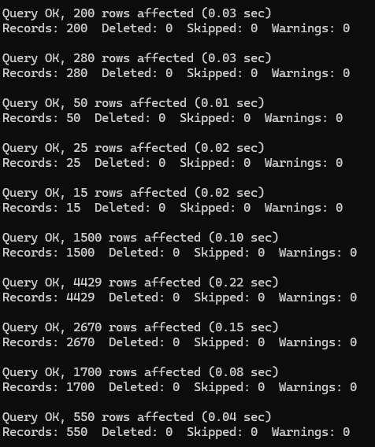](images/preuve_load_data.png)
🔍 *[Ouvrir la capture d'écran en taille réelle : preuve_load_data.png](images/preuve_load_data.png)*

Preuve de chargement des données

- Synthèse des volumes importés : 200 clients, 280 adresses, 50 articles, 25 toppings, 15 livreurs, 1’500 commandes, 4’429 lignes de commande, 2’670 toppings facturés, 1’700 paiements, 550 livraisons.

---

## 5. Sauvegarde et restauration (Section 3.4)

### 5.1 Procédure de test

Dans un environnement de production, la mise en œuvre d’une sauvegarde à froid ou à chaud permet de prévenir les sinistres. La procédure de vérification a suivi 4 phases :

1. **Sauvegarde intégrale avec mysqldump :**
    
    ```bash
    mysqldump -uroot -proot db_thanospizza > db_sauvegarde_thanospizza.sql
    ```
    
    [](images/5.1%20Sauvegarde%20intégrale%20avec%20mysqldump.png)
    *Preuve d’exécution : Exportation complète du schéma et des données avec mysqldump.*
    
2. **Altération volontaire des données (tests d’insertion et modification) :**
    
    ```sql
    -- Insertion de deux enregistrements tests
    INSERT INTO t_ligne_topping (ligne_commande_fk, topping_fk, prix_facture)
    VALUES (13, 8, 9.00), (8, 13, 2.00);
    
    -- Modification d'un enregistrement
    UPDATE t_ligne_topping
    SET prix_facture = 3.50
    WHERE ligne_commande_fk = 13 AND topping_fk = 8;
    ```
    
3. **Restauration de la base à partir du fichier d’archive :**
    
    ```bash
    mysql -uroot -proot db_thanospizza < /scripts/db_sauvegarde_thanospizza.sql
    ```
    
4. **Vérification du résultat et démonstration complète (Améliorations Jalon 80%) :**

Pour satisfaire aux exigences de traçabilité et de sécurité formulées lors du jalon 80% ([`eval_retour_80%.docx`](./eval_retour_80%.docx)), une démonstration explicite de l'état des données a été réalisée avant et après restauration :

- **Sécurisation de la procédure de restauration :** Le dump SQL généré par `mysqldump` inclut systématiquement la directive `DROP TABLE IF EXISTS` préalablement à chaque recréation de table. Lors de la restauration, toutes les écritures parasites et modifications intervenues postérieurement à la sauvegarde sont ainsi automatiquement détruites, garantissant que la base est ramenée de manière étanche à son état exact de sauvegarde.
- **Démonstration visuelle de l'état des données :**

| Données altérées après la sauvegarde (Avant restauration) | Données remises à l'état initial (Après restauration) |
| :---: | :---: |
| [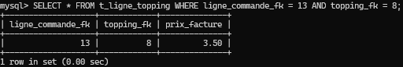](images/preuve_restaur_avant_backup.png) | [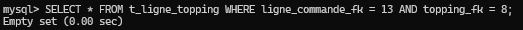](images/preuve_restaur_apres.png) |
| L'enregistrement modifié (`prix_facture = 3.50`) est présent dans la table. | La table est restaurée : l'enregistrement n'existe plus (`Empty set (0.00 sec)`), confirmant la disparition complète des ajouts parasites. |

---

## 6. Requêtes SQL (Section 3.5)

Toutes les requêtes ci-dessous ont été rédigées avec des alias explicites et testées sur le jeu de données réel.

### Requête n°1 — Pizzas les plus vendues

- **Énoncé :** Afficher les 10 pizzas les plus vendues, sans tenir compte des toppings, avec leur nom et la quantité totale vendue, triée par ordre décroissant.
- **Concepts utilisés :** Jointure interne `INNER JOIN`, agrégation `SUM()`, `GROUP BY` sur clé primaire et nom, tri décroissant et restriction `LIMIT 10`.

```sql
SELECT
    a.nom AS 'Pizza',
    SUM(lc.quantite) AS 'Quantite_totale'
FROM t_article AS a
INNER JOIN t_ligne_commande AS lc ON lc.article_fk = a.article_id
WHERE a.type = 'pizza'
GROUP BY a.article_id, a.nom
ORDER BY Quantite_totale DESC
LIMIT 10;
```

[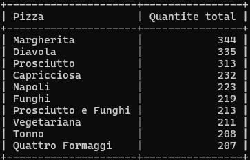](images/requete1.png)
*Preuve d’exécution : Les 10 pizzas les plus vendues dans la base de données.*


---

### Requête n°2 — Toppings les plus populaires

- **Énoncé :** Afficher les toppings les plus ajoutés aux pizzas, avec le nom et la quantité totale. Si une ligne contient plusieurs pizzas identiques, le topping s’applique à chacune d’elles.
- **Concepts utilisés :** Double jointure `INNER JOIN` (table pivot `t_ligne_topping`), cumul via `SUM(lc.quantite)` pour respecter la multiplication par pizza de la ligne.

```sql
SELECT
    t.nom AS 'Topping',
    SUM(lc.quantite) AS 'Quantite_totale'
FROM t_topping AS t
INNER JOIN t_ligne_topping AS lt ON lt.topping_fk = t.topping_id
INNER JOIN t_ligne_commande AS lc ON lc.ligne_commande_id = lt.ligne_commande_fk
GROUP BY t.topping_id, t.nom
ORDER BY Quantite_totale DESC;
```

[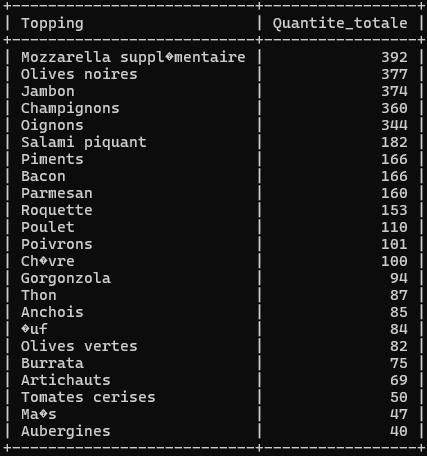](images/requete2.png)
*Preuve d’exécution : Classement des toppings les plus populaires.*


---

### Requête n°3 — Chiffre d’affaires par jour

- **Énoncé :** Afficher le chiffre d’affaires réalisé chaque jour pour les commandes livrées (somme des paiements encaissés), arrondi à deux décimales, trié chronologiquement.
- **Concepts utilisés :** Extraction de la date sans heure avec `DATE(c.date_creation)` afin de regrouper par jour civil complet, calcul de somme avec `ROUND(SUM(), 2)`, tri chronologique.

```sql
SELECT
    DATE(c.date_creation) AS 'Date',
    ROUND(SUM(p.montant), 2) AS 'Chiffre_affaires'
FROM t_commande AS c
INNER JOIN t_paiement AS p ON p.commande_fk = c.commande_id
WHERE c.statut = 'livree'
GROUP BY DATE(c.date_creation)
ORDER BY Date ASC;
```

[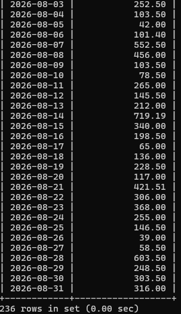](images/requete3.png)
*Preuve d’exécution : Chiffre d'affaires journalier réalisé sur les commandes livrées.*


---

### Requête n°4 — Chiffre d’affaires par zone de livraison

- **Énoncé :** Afficher le chiffre d’affaires pour chaque NPA de livraison pour les commandes livrées à domicile, arrondi à deux décimales, trié du plus élevé au plus faible.
- **Concepts utilisés :** Multi-jointure (`t_adresse`, `t_commande`, `t_paiement`), double filtre `WHERE`, regroupement spatial (`a.npa`, `a.localite`), arrondi `ROUND()`.

```sql
SELECT
    a.npa AS 'NPA',
    a.localite AS 'Localite',
    ROUND(SUM(p.montant), 2) AS 'Chiffre_affaires'
FROM t_adresse AS a
INNER JOIN t_commande AS c ON c.adresse_livraison_fk = a.adresse_id
INNER JOIN t_paiement AS p ON p.commande_fk = c.commande_id
WHERE c.type = 'livraison' AND c.statut = 'livree'
GROUP BY a.npa, a.localite
ORDER BY Chiffre_affaires DESC;
```

[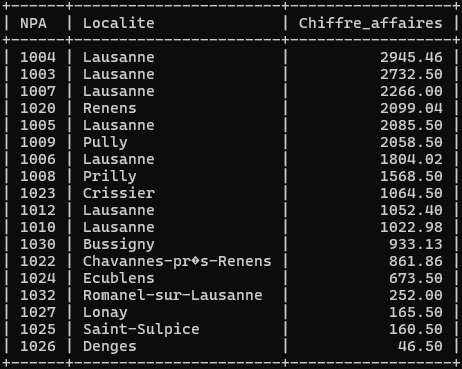](images/requete4.png)
*Preuve d’exécution : Chiffre d'affaires ventilé par zone NPA de livraison.*


---

### Requête n°5 — Heures chaudes

- **Énoncé :** Afficher le nombre de commandes créées pour chaque heure de la journée, trié par volume décroissant pour repérer les pics d’activité.
- **Concepts utilisés :** Fonction temporelle `HOUR()`, fonction de comptage `COUNT()`, tri statistique décroissant.

```sql
SELECT
    HOUR(date_creation) AS 'Heure',
    COUNT(commande_id) AS 'Nombre_commandes'
FROM t_commande
GROUP BY HOUR(date_creation)
ORDER BY Nombre_commandes DESC;
```

[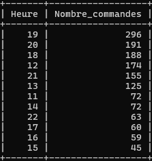](images/requete5.png)
*Preuve d’exécution : Analyse des heures de pointe (heures chaudes).*

---

### Requête n°6 — Clients fidèles

- **Énoncé :** Afficher les clients ayant passé au moins 5 commandes (nom, prénom, nombre de commandes), trié par nombre de commandes décroissant puis par nom alphabétique.
- **Concepts utilisés :** Jointure `INNER JOIN`, agrégation `COUNT()`, filtrage post-agrégation `HAVING COUNT(...) >= 5`, tri multi-critères.

```sql
SELECT
    c.nom AS 'Nom',
    c.prenom AS 'Prenom',
    COUNT(co.commande_id) AS 'Nombre_commandes'
FROM t_client AS c
INNER JOIN t_commande AS co ON co.client_fk = c.client_id
GROUP BY c.client_id, c.nom, c.prenom
HAVING COUNT(co.commande_id) >= 5
ORDER BY Nombre_commandes DESC, c.nom ASC;
```

[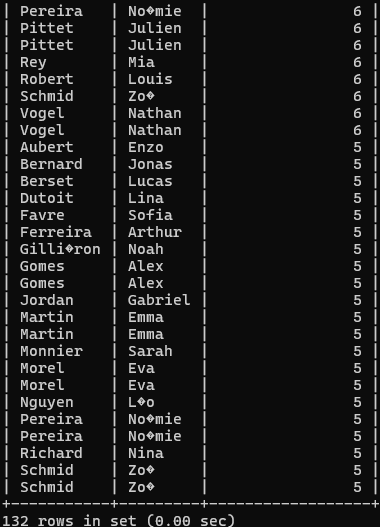](images/requete6.png)
*Preuve d’exécution : Liste des clients fidèles (>= 5 commandes).*


---

### Requête n°7 — Situation financière des commandes

- **Énoncé :** Pour chaque commande, afficher son identifiant, le montant total dû (articles + toppings), le montant payé et le restant à payer, arrondi à 2 décimales. Utilisation de `COALESCE()`.
- **Concepts utilisés :** Sous-requêtes d’agrégation indépendantes pour éviter les produits cartésiens de doublons, jointures externes `LEFT JOIN`, gestion des valeurs nulles avec `COALESCE()`, fonction d’arrondi `ROUND(..., 2)`, tri croissant `ORDER BY`.

```sql
SELECT 
    c.commande_id AS 'N° Commande',
    ROUND(
        COALESCE(articles.total_articles, 0) + COALESCE(toppings.total_toppings, 0), 
        2
    ) AS 'Montant total dû',
    ROUND(COALESCE(paiements.total_paye, 0), 2) AS 'Montant total payé',
    ROUND(
        (COALESCE(articles.total_articles, 0) + COALESCE(toppings.total_toppings, 0)) - COALESCE(paiements.total_paye, 0), 
        2
    ) AS 'Restant à payer'
FROM t_commande AS c
-- Sous-requête 1 : total des articles par commande
LEFT JOIN (
    SELECT lc.commande_fk, SUM(lc.quantite * lc.prix_unitaire) AS total_articles
    FROM t_ligne_commande AS lc
    GROUP BY lc.commande_fk
) AS articles ON articles.commande_fk = c.commande_id
-- Sous-requête 2 : total des toppings par commande (si présents)
LEFT JOIN (
    SELECT lc.commande_fk, SUM(lc.quantite * lt.prix_facture) AS total_toppings
    FROM t_ligne_commande AS lc
    INNER JOIN t_ligne_topping AS lt ON lt.ligne_commande_fk = lc.ligne_commande_id
    GROUP BY lc.commande_fk
) AS toppings ON toppings.commande_fk = c.commande_id
-- Sous-requête 3 : total des paiements perçus (gestion des acomptes et impayés)
LEFT JOIN (
    SELECT p.commande_fk, SUM(p.montant) AS total_paye
    FROM t_paiement AS p
    GROUP BY p.commande_fk
) AS paiements ON paiements.commande_fk = c.commande_id
ORDER BY c.commande_id ASC;
```

#### Extrait des résultats obtenus :

| N° Commande | Montant total dû (CHF) | Montant total payé (CHF) | Restant à payer (CHF) |
| :---: | :---: | :---: | :---: |
| **1** | 49.50 | 49.50 | 0.00 |
| **2** | 10.00 | 10.00 | 0.00 |
| **3** | 120.00 | 120.00 | 0.00 |
| **4** | 56.00 | 56.00 | 0.00 |
| **5** | 108.50 | 108.50 | 0.00 |
| ... | ... | ... | ... |
| **101** | **52.50** | **52.50** | **0.00** |
| **102** | **49.00** | **22.05** | **26.95** |
| **103** | **30.50** | **30.50** | **0.00** |

[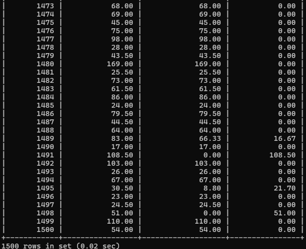](images/requete7.png)
*Preuve d’exécution : Situation financière complète (montant dû, payé, restant).*


---

### Requête n°8 — Répartition des types de commandes

- **Énoncé :** Afficher le nombre de commandes par type (`sur_place`, `emporter`, `livraison`), trié par fréquence décroissante.
- **Concepts utilisés :** Regroupement par champ d’énumération, fonction `COUNT()`, tri décroissant.

```sql
SELECT
    type AS 'Type_commande',
    COUNT(commande_id) AS 'Nombre_commandes'
FROM t_commande
GROUP BY type
ORDER BY Nombre_commandes DESC;
```

[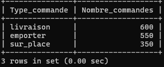](images/requete8.png)
*Preuve d’exécution : Répartition des commandes par mode de consommation.*


---

### Requête n°9 — Performance des livreurs

- **Énoncé :** Calculer le délai moyen de livraison en minutes pour chaque livreur pour les courses terminées (départ et arrivée non nuls), trié du plus rapide au plus lent.
- **Concepts utilisés :** Calcul d’intervalle `TIMESTAMPDIFF(MINUTE, ...)`, moyenne arithmétique `AVG()`, filtrage `IS NOT NULL`, tri ascendant.

```sql
SELECT
    l.livreur_id AS 'Livreur_ID',
    l.nom AS 'Nom',
    l.prenom AS 'Prenom',
    ROUND(AVG(TIMESTAMPDIFF(MINUTE, li.heure_depart, li.heure_arrivee)), 1) AS 'Delai_moyen_minutes'
FROM t_livreur AS l
INNER JOIN t_livraison AS li ON li.livreur_fk = l.livreur_id
WHERE li.heure_depart IS NOT NULL
  AND li.heure_arrivee IS NOT NULL
GROUP BY l.livreur_id, l.nom, l.prenom
ORDER BY Delai_moyen_minutes ASC;
```

[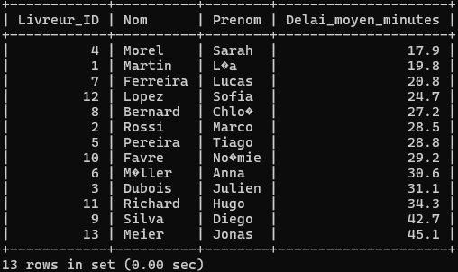](images/requete9.png)
*Preuve d’exécution : Délai moyen de livraison par livreur.*


---

### Requête n°10 — Tous les clients

- **Énoncé :** Afficher l’intégralité des clients avec leur nombre de commandes, y compris ceux n’ayant jamais commandé (0 commande), trié par nombre de commandes décroissant.
- **Concepts utilisés :** Jointure externe gauche `LEFT JOIN`, dénombrement `COUNT(co.commande_id)` préservant les zéros, regroupement sur clé primaire `client_id` évitant la fusion d’homonymes.

```sql
SELECT
    c.nom AS 'Nom',
    c.prenom AS 'Prenom',
    COUNT(co.commande_id) AS 'Nombre_commandes'
FROM t_client AS c
LEFT JOIN t_commande AS co ON co.client_fk = c.client_id
GROUP BY c.client_id, c.nom, c.prenom
ORDER BY Nombre_commandes DESC, c.nom ASC;
```

[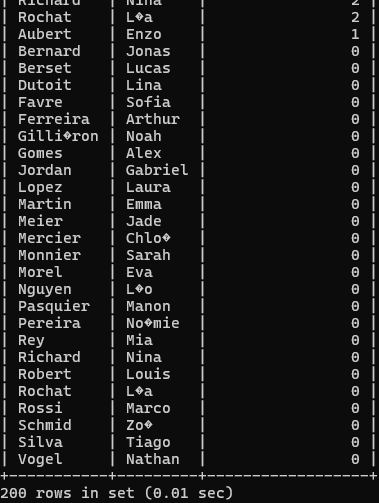](images/requete10.png)
*Preuve d’exécution : Historique des commandes de l'intégralité des clients.*

---

### Requête n°11 — Articles jamais commandés

- **Énoncé :** Afficher les articles jamais commandés au moyen d’une sous-requête obligatoire, triés par ordre alphabétique.
- **Concepts utilisés :** Sous-requête non corrélée, clause d’exclusion `NOT IN`, suppression des doublons `DISTINCT`, tri alphabétique.

```sql
SELECT
    nom AS 'Article'
FROM t_article
WHERE article_id NOT IN (
    SELECT DISTINCT article_fk
    FROM t_ligne_commande
    WHERE article_fk IS NOT NULL
)
ORDER BY nom ASC;
```

[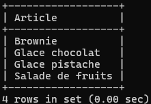](images/requete11.png)
*Preuve d’exécution : Identification des articles n'ayant jamais été commandés.*

---

### Requête n°12 — Contrôle des numéros de téléphone

- **Énoncé :** Vérifier à l’aide de `REGEXP` que les téléphones respectent le format suisse `+41 XX XXX XX XX`. Afficher le nombre total de clients, les valides et les invalides.
- **Concepts utilisés :** Expression régulière avec ancrage de début et fin (`^...$`), agrégation conditionnelle `SUM(CASE WHEN ... THEN 1 ELSE 0 END)`.

```sql
SELECT
    COUNT(client_id) AS 'Total_clients',
    SUM(CASE WHEN telephone REGEXP '^\\+41 [0-9]{2} [0-9]{3} [0-9]{2} [0-9]{2}$' THEN 1 ELSE 0 END) AS 'Numeros_valides',
    SUM(CASE WHEN telephone NOT REGEXP '^\\+41 [0-9]{2} [0-9]{3} [0-9]{2} [0-9]{2}$' THEN 1 ELSE 0 END) AS 'Numeros_invalides'
FROM t_client;
```

[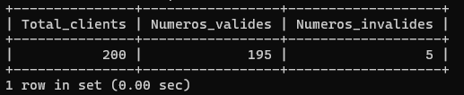](images/requete12.png)
*Preuve d’exécution : Contrôle de conformité regex des numéros de téléphone suisses.*

---

## 7. Analyse et optimisation des index (Section 3.6)

### 7.1 Analyse de la Requête n°1

```sql
SELECT c.commande_id, c.date_creation, c.statut, cl.nom AS client
FROM t_commande AS c
INNER JOIN t_client AS cl ON c.client_fk = cl.client_id
WHERE c.statut = 'en_livraison'
  AND c.date_creation > '2026-01-01'
ORDER BY c.date_creation DESC;
```

1. **Identification des colonnes utilisées :**
    - Clause `JOIN` : `c.client_fk` (clé étrangère), `cl.client_id` (clé primaire).
    - Clause `WHERE` : `c.statut` (égalité), `c.date_creation` (plage).
    - Clause `ORDER BY` : `c.date_creation DESC`.
2. **Index existants :**
    - Clé primaire sur `t_client(client_id)`.
    - Clé primaire sur `t_commande(commande_id)`.
    - Index automatique sur la clé étrangère `t_commande(client_fk)`.
3. **Index proposé et justification :**
Le moteur doit filtrer sur `statut`, restreindre par date et trier le résultat dans l’ordre décroissant. Un index composite permet de satisfaire à la fois le filtre et le tri sans opération de `filesort` en mémoire :
    
    ```sql
    CREATE INDEX idx_commande_statut_date ON t_commande (statut, date_creation);
    ```

#### Validation de l'utilisation effective avec EXPLAIN (Jalon 80%) :
Conformément aux demandes du retour d'évaluation 80%, l'utilisation effective de l'index a été vérifiée avant et après sa création :
- **Avant indexation :** Le moteur MySQL exécute un balayage séquentiel complet (`type: ALL`, 200 lignes examinées) et doit recourir à un tri externe temporaire (`Using temporary; Using filesort`).
- **Après création de `idx_commande_statut_date` :** L'accès bascule immédiatement en recherche par plage (`type: range`, 90 lignes examinées) exploitant l'index composite (`key: idx_commande_statut_date`). L'opération coûteuse de `filesort` est totalement supprimée car les données sont déjà indexées dans l'ordre chronologique attendu.

[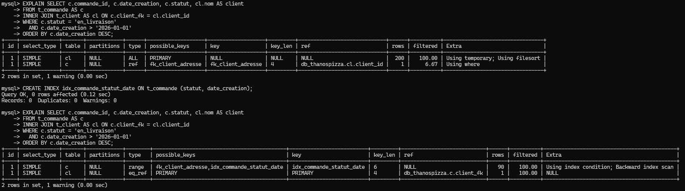](images/index_preuve_1.png)
*Preuve d’exécution : Comparatif du plan EXPLAIN avant et après création de `idx_commande_statut_date`.*

---

### 7.2 Analyse de la Requête n°2

```sql
SELECT a.npa AS zone_npa, COUNT(c.commande_id) AS nb_commandes
FROM t_commande AS c
INNER JOIN t_adresse AS a ON c.adresse_livraison_fk = a.adresse_id
WHERE c.type = 'livraison'
  AND HOUR(c.date_creation) BETWEEN 18 AND 21
GROUP BY a.npa
ORDER BY nb_commandes DESC;
```

1. **Identification des colonnes utilisées :**
    - Clause `JOIN` : `c.adresse_livraison_fk`, `a.adresse_id`.
    - Clause `WHERE` : `c.type`, `c.date_creation` (encapsulée dans `HOUR()`).
    - Clause `GROUP BY` : `a.npa`.
    - Clause `ORDER BY` : agrégat `COUNT(c.commande_id)`.
2. **Index existants :**
    - Clé primaire sur `t_adresse(adresse_id)`.
    - Index de clé étrangère sur `t_commande(adresse_livraison_fk)`.
3. **Index proposés et justification :**
    - **Remarque technique :** `npa` appartient à la table `t_adresse` et `type` appartient à `t_commande`. Il est donc impossible de créer un index composite unique mélangeant ces deux tables.
    - Sur `t_commande` : Un index composite `(type, adresse_livraison_fk)` permet d’éliminer immédiatement toutes les commandes qui ne sont pas des livraisons, puis d’effectuer la jointure de manière directe.
    - Sur `t_adresse` : Un index sur `npa` accélère le regroupement (`GROUP BY`).
    
    ```sql
    -- Optimisation du regroupement spatial et de la jointure
    CREATE INDEX idx_commande_type_adresse ON t_commande (type, adresse_livraison_fk);
    ```

#### Validation de l'utilisation effective avec EXPLAIN (Jalon 80%) :
L'utilisation effective de ce second index composite a été vérifiée au moyen de la commande `EXPLAIN` :
- **Avant indexation :** Le moteur effectue un balayage complet (`type: ALL`, 280 lignes) avec `Using temporary; Using filesort` pour filtrer les types et effectuer les jointures.
- **Après création de `idx_commande_type_adresse` :** Le plan d'exécution bascule en accès par référence (`type: ref`), utilisant directement la clé `idx_commande_type_adresse` pour éliminer dès la lecture les commandes hors livraison et effectuer la jointure directe avec `t_adresse`.

[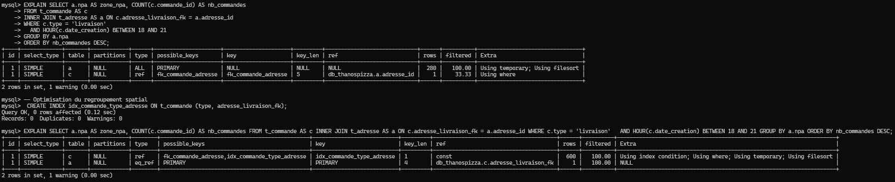](images/index_preuve_2.png)
*Preuve d’exécution : Comparatif du plan EXPLAIN avant et après création de `idx_commande_type_adresse`.*

---

## 8. Gestion des utilisateurs et des rôles (Section 3.7)

Une politique de sécurité rigoureuse exige le principe de moindre privilège (Principle of Least Privilege). Les rôles suivants ont été implémentés dans MySQL 8.0 :

### 8.1 Matrice des privilèges

- **r_admin :** Tous les droits sur le schéma et gestion des comptes utilisateurs.
- **r_manager :** Lecture globale, modifications sur les commandes, lignes, livraisons, catalogue et toppings. Consultation des paiements (sans modification).
- **r_pizzaiolo :** Consultation des commandes, lignes, articles et toppings. Modification exclusive autorisée sur la colonne `statut` de `t_commande`. Aucun droit sur les paiements.
- **r_livreur :** Consultation des livraisons, commandes et adresses clients. Modification autorisée sur `heure_depart` et `heure_arrivee` dans `t_livraison`, et sur `statut` dans `t_commande`.
- **r_caisse :** Consultation des commandes, lignes et catalogue. Saisie (`INSERT`) et consultation (`SELECT`) des paiements dans `t_paiement`.
- **r_analyste :** Lecture seule intégrale (`SELECT`) pour les statistiques décisionnelles.

### 8.2 Script de mise en œuvre

```sql
-- 1. Création des rôles
CREATE ROLE 'r_admin', 'r_manager', 'r_pizzaiolo', 'r_livreur', 'r_caisse', 'r_analyste';
```
[](images/creation_role.png)

```sql

-- 2. Affectation des privilèges
GRANT ALL PRIVILEGES ON db_thanospizza.* TO 'r_admin' WITH GRANT OPTION;
GRANT CREATE USER, ROLE_ADMIN ON *.* TO 'r_admin';
```
[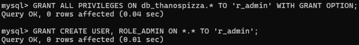](images/droits_admin.png)

```sql

GRANT SELECT ON db_thanospizza.* TO 'r_manager';
GRANT INSERT, UPDATE, DELETE ON db_thanospizza.t_commande TO 'r_manager';
GRANT INSERT, UPDATE, DELETE ON db_thanospizza.t_ligne_commande TO 'r_manager';
GRANT INSERT, UPDATE, DELETE ON db_thanospizza.t_ligne_topping TO 'r_manager';
GRANT INSERT, UPDATE, DELETE ON db_thanospizza.t_livraison TO 'r_manager';
GRANT INSERT, UPDATE, DELETE ON db_thanospizza.t_article TO 'r_manager';
GRANT INSERT, UPDATE, DELETE ON db_thanospizza.t_topping TO 'r_manager';
```
[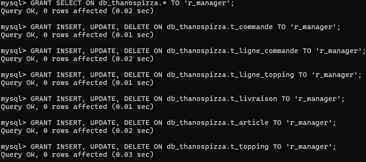](images/droits_manager.png)

```sql

GRANT SELECT ON db_thanospizza.t_commande TO 'r_pizzaiolo';
GRANT SELECT ON db_thanospizza.t_ligne_commande TO 'r_pizzaiolo';
GRANT SELECT ON db_thanospizza.t_article TO 'r_pizzaiolo';
GRANT SELECT ON db_thanospizza.t_topping TO 'r_pizzaiolo';
GRANT SELECT ON db_thanospizza.t_ligne_topping TO 'r_pizzaiolo';
GRANT UPDATE (statut) ON db_thanospizza.t_commande TO 'r_pizzaiolo';
```
[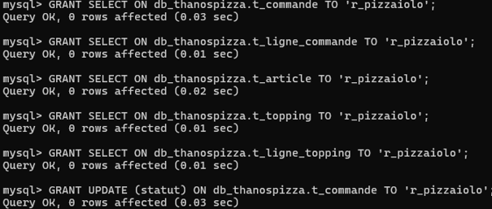](images/droits_pizaiolo.png)

```sql

GRANT SELECT ON db_thanospizza.t_livraison TO 'r_livreur';
GRANT SELECT ON db_thanospizza.t_commande TO 'r_livreur';
GRANT SELECT ON db_thanospizza.t_adresse TO 'r_livreur';
GRANT UPDATE (heure_depart, heure_arrivee) ON db_thanospizza.t_livraison TO 'r_livreur';
GRANT UPDATE (statut) ON db_thanospizza.t_commande TO 'r_livreur';
```
[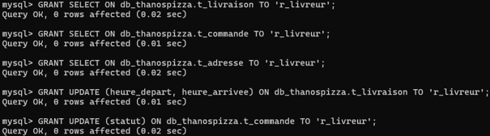](images/droits_livreur.png)

```sql
GRANT SELECT ON db_thanospizza.t_commande TO 'r_caisse';
GRANT SELECT ON db_thanospizza.t_ligne_commande TO 'r_caisse';
GRANT SELECT ON db_thanospizza.t_ligne_topping TO 'r_caisse';
GRANT SELECT ON db_thanospizza.t_article TO 'r_caisse';
GRANT SELECT, INSERT ON db_thanospizza.t_paiement TO 'r_caisse';
```
[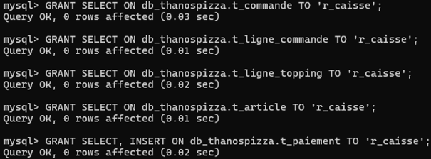](images/droits_caisse.png)

```sql
GRANT SELECT ON db_thanospizza.* TO 'r_analyste';
```
[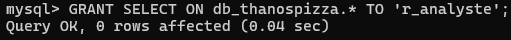](images/droits_analyste.png)

```sql

-- 3. Création des comptes utilisateurs
CREATE USER 'u_admin'@'%' IDENTIFIED BY 'Admin2026!';
CREATE USER 'u_manager'@'%' IDENTIFIED BY 'Manager2026!';
CREATE USER 'u_pizza'@'%' IDENTIFIED BY 'Pizza2026!';
CREATE USER 'u_livreur'@'%' IDENTIFIED BY 'Livreur2026!';
CREATE USER 'u_caisse'@'%' IDENTIFIED BY 'Caisse2026!';
CREATE USER 'u_analyste'@'%' IDENTIFIED BY 'Analyste2026!';
```
[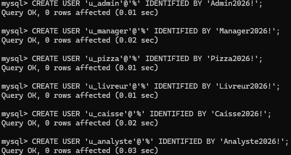](images/creation_utilisateurs.png)

```sql

-- 4. Attribution et activation des rôles
GRANT 'r_admin' TO 'u_admin'@'%';
GRANT 'r_manager' TO 'u_manager'@'%';
GRANT 'r_pizzaiolo' TO 'u_pizza'@'%';
GRANT 'r_livreur' TO 'u_livreur'@'%';
GRANT 'r_caisse' TO 'u_caisse'@'%';
GRANT 'r_analyste' TO 'u_analyste'@'%';
```
[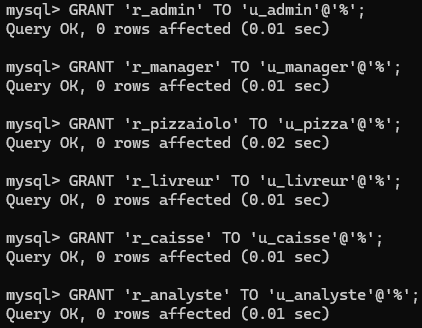](images/attribute_role.png)

```sql

SET DEFAULT ROLE ALL TO
  'u_admin'@'%', 'u_manager'@'%', 'u_pizza'@'%',
  'u_livreur'@'%', 'u_caisse'@'%', 'u_analyste'@'%';

FLUSH PRIVILEGES;
```

| Rôles par défaut actifs | Rechargement des privilèges |
| :---: | :---: |
| [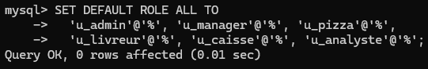](images/set_default.png) | [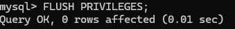](images/flush.png) |


---

## 9. Transactions et intégrité des données (Section 3.8)

Une transaction est une unité logique de travail qui garantit les propriétés fondamentales **ACID** (Atomicité, Cohérence, Isolation, Durabilité). Dans un système de gestion de commandes et de livraisons comme **ThanosPizza**, les transactions évitent toute désynchronisation critique ou perte financière en cas d'erreur ou d'interruption réseau.

Conformément au cahier des charges, deux cas d'usage de transactions ont été modélisés, scriptés et validés :

---

### 9.1 Cas n°1 : Annulation d'une commande (Commande n°103)

#### Contexte métier et objectif
Le client demande l'annulation de la commande `103`. Le système d'information doit garantir l'exécution atomique des opérations suivantes :
1. **Suppression de la livraison associée :** La ligne liée à la commande `103` dans la table `t_livraison` doit être immédiatement supprimée pour désassigner le livreur et annuler la tournée.
2. **Mise à jour du statut de la commande :** Le statut dans la table `t_commande` doit passer à `'annulee'`.
3. **Conservation des écritures de paiement :** Les enregistrements existants dans la table `t_paiement` sont impérativement préservés afin de conserver la traçabilité comptable et permettre la procédure de remboursement financier.

#### Script SQL de la transaction
```sql
START TRANSACTION;

-- Étape 1 : Suppression de la livraison assignée à la commande 103
DELETE FROM t_livraison 
WHERE commande_fk = 103;

-- Étape 2 : Mise à jour du statut de la commande à 'annulee'
UPDATE t_commande 
SET statut = 'annulee' 
WHERE commande_id = 103;

-- Étape 3 : Validation définitive des opérations
COMMIT;
```

#### Justification de l'atomicité et utilisation du ROLLBACK
- **Atomicité requise :** Les deux requêtes `DELETE` et `UPDATE` doivent impérativement former un bloc inséparable. Si la suppression de la livraison réussit mais que la mise à jour du statut échoue (ou inversement), la base de données se retrouverait dans un état incohérent (par exemple, un livreur effectuant une livraison pour une commande déjà annulée, ou une commande annulée conservant un créneau de livraison actif).
- **Scénario d'utilisation du ROLLBACK :**  
  Le `ROLLBACK` intervient dès qu'une erreur technique ou une violation de contrainte d'intégrité survient lors de l'exécution de l'une des requêtes. En déclenchant un `ROLLBACK`, le SGBD annule l'intégralité des modifications apportées depuis le `START TRANSACTION` et restaure l'état exact antérieur de la base de données.

---

### 9.2 Cas n°2 : Contrôle financier avant expédition en livraison (Commandes n°101 et n°102)

#### Règle de gestion
Une commande destinée à la livraison à domicile ne peut être confiée au livreur et passer au statut `'en_livraison'` que si elle a été **intégralement réglée** au préalable par le client :
$$\text{Total Payé} \ge \text{Total Dû (Articles + Toppings)}$$

Si le montant payé est strictement inférieur au montant dû, l'opération de mise en livraison doit être annulée (`ROLLBACK`) et le statut de la commande doit rester inchangé (`en_preparation`).

---

#### Test A : Commande n°101 (Commande intégralement réglée $\rightarrow$ COMMIT)

- **Calcul du montant dû :**
  - Articles : 1x Pizza Margherita (15.00 CHF) + 1x Pizza Quattro Stagioni (22.00 CHF) + 1x Tiramisu (8.00 CHF) + 1x Coca-Cola (5.00 CHF) = 50.00 CHF.
  - Suppléments / Toppings : 1x Gorgonzola (2.50 CHF) = 2.50 CHF.
  - **Total dû = 52.50 CHF**.
- **Calcul du montant payé :**
  - Paiement 1 (Twint) : 21.00 CHF.
  - Paiement 2 (Twint) : 31.50 CHF.
  - **Total payé = 52.50 CHF**.
- **Évaluation :** Condition remplie ($52.50 \ge 52.50$) $\rightarrow$ Statut mis à jour à `'en_livraison'` et validation permanente via **`COMMIT`**.

```sql
START TRANSACTION;

-- 1. Calcul dynamique du montant total dû pour la commande 101
SET @du = (
    SELECT SUM(quantite * prix_unitaire) 
    FROM t_ligne_commande 
    WHERE commande_fk = 101
) + COALESCE((
    SELECT SUM(lc.quantite * lt.prix_facture)
    FROM t_ligne_commande lc
    JOIN t_ligne_topping lt ON lt.ligne_commande_fk = lc.ligne_commande_id
    WHERE lc.commande_fk = 101
), 0);

-- 2. Calcul du montant total perçu pour la commande 101
SET @paye = COALESCE((
    SELECT SUM(montant) 
    FROM t_paiement 
    WHERE commande_fk = 101
), 0);

-- 3. Mise à jour du statut car la condition (@paye >= @du) est satisfaite
UPDATE t_commande 
SET statut = 'en_livraison' 
WHERE commande_id = 101;

-- 4. Validation définitive des modifications
COMMIT;
```

---

#### Test B : Commande n°102 (Commande avec solde impayé $\rightarrow$ ROLLBACK)

- **Calcul du montant dû :**
  - Articles : 2x Pizza Prosciutto (2x 18.00 = 36.00 CHF) + 1x Tiramisu (8.00 CHF) + 1x Bière Moretti (5.00 CHF) = 49.00 CHF.
  - Suppléments / Toppings : aucun.
  - **Total dû = 49.00 CHF**.
- **Calcul du montant payé :**
  - Paiement 1 (Twint) : 22.05 CHF.
  - **Total payé = 22.05 CHF**.
- **Solde restant à régler :** $49.00 - 22.05 = 26.95\text{ CHF}$ (solde débiteur).
- **Évaluation :** Condition non satisfaite ($22.05 < 49.00$) $\rightarrow$ La marchandise ne doit pas quitter la pizzeria. La transaction est rejetée et annulée via **`ROLLBACK`**.

```sql
START TRANSACTION;

-- 1. Calcul dynamique du montant total dû pour la commande 102 (49.00 CHF)
SET @du = (
    SELECT SUM(quantite * prix_unitaire) 
    FROM t_ligne_commande 
    WHERE commande_fk = 102
) + COALESCE((
    SELECT SUM(lc.quantite * lt.prix_facture)
    FROM t_ligne_commande lc
    JOIN t_ligne_topping lt ON lt.ligne_commande_fk = lc.ligne_commande_id
    WHERE lc.commande_fk = 102
), 0);

-- 2. Calcul du montant perçu (22.05 CHF)
SET @paye = COALESCE((
    SELECT SUM(montant) 
    FROM t_paiement 
    WHERE commande_fk = 102
), 0);

-- 3. Règle non satisfaite (@paye < @du) : l'opération est refusée
-- Annulation intégrale pour empêcher toute mise à jour non autorisée :
ROLLBACK;
```

*Résultat constaté :* La commande `102` conserve son statut `en_preparation` dans la base de données. Aucun livreur n'est déployé pour un montant impayé.

---

## 10. Utilisation de l’intelligence artificielle (Section 3.9)

Conformément aux directives de l’école ETML et du cahier des charges :

- **Prompt donné à l'IA :**  
  > *« Je travaille actuellement sur un projet pour le module C106 ; il s'agit d'analyser en profondeur le cahier des charges (CdC), puis d'analyser tout aussi soigneusement le rapport que j'ai rédigé à partir de ce document. Je précise d'emblée que je n'ai pas terminé le projet. Ta mission consistera ensuite à vérifier que toutes mes réponses sont valides et conformes aux exigences du cahier des charges. Découpe cette consigne en plusieurs étapes et procède étape par étape. Ces documents se trouvent sur le disque T7, dans le dossier `106_Module > Projet`. Le dossier contenant mon rapport est `Rapport.docx` et celui du cahier des charges est `P_DB106_Pizzeria_Cahier_des_charges_V2`. »*

- **Documents annexes et livrables associés :**  
  L'ensemble des fichiers réels du projet est accessible via les liens directs suivants :
  - [📄 Rapport.docx](./info_manuel/Rapport%2019.52.37.docx) : Rapport de travail personnel initial et complété sous Word.
  - [📄 db_thanospizza.sql](./db/db_thanospizza.sql) : Script SQL complet (DDL, contraintes CHECK et commandes LOAD DATA).
  - [📄 db_sauvegarde_thanospizza.sql](./db/db_sauvegarde_thanospizza.sql) : Fichier de sauvegarde intégrale issu de mysqldump.
  - [📊 T-POO-pr55xpt.xlsm](./T-POO-pr55xpt.xlsm) : Journal de travail (JdT) et suivi de planification (Semaines 1 à 5).
  - [📄 Requetes.txt](./info_manuel/Requetes.txt) : Brouillons et notes de travail des requêtes SQL.
  - [📄 P_DB_106-Tsybulevskyi.loo](./info_manuel/P_DB_106-Tsybulevskyi.loo) : Fichier source de modélisation MERISE sous Looping.

- **Outils utilisés :**  
  Modèle d’intelligence artificielle agentique (Antigravity).

- **Objectif de l’assistance :**
    1. Audit de conformité des requêtes SQL par rapport aux contraintes métier complexes du cahier des charges.
    2. Revue critique de l’analyse d’index pour identifier les erreurs sur les tables cibles (incompatibilité d’index multi-tables).
    3. Aide à la formulation et à la structure académique du rapport technique en français.

- **Méthode de vérification humaine :**  
  Chaque script SQL et chaque résultat proposé ont été exécutés et validés pas à pas dans l’environnement de test sur les données réelles issues des fichiers TSV, en contrôlant personnellement la logique d’agrégation et les clés d’intégrité.

---

## 11. Validation et signatures

Rapport lu et approuvé.

**L'apprenti :**  
Nom et prénom : Maksym Tsybulevskyi  
Signature : ___________________________  
Date : 30 / 10 / 2026  

**Le chef de projet / Enseignant :**  
Nom et prénom : ___________________________  
Signature : ___________________________  
Date : ___ / ___ / 2026
